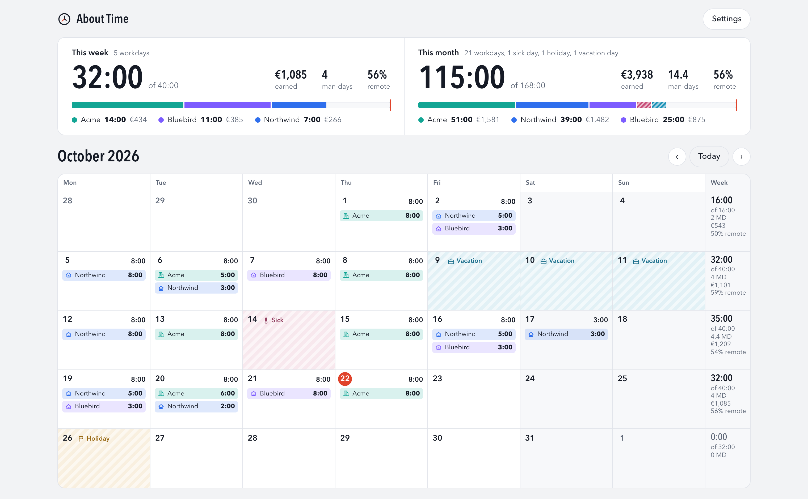

# About Time

A free and open source billable-hours tracker for contractors, with multi-client support. It runs locally on macOS and opens in your browser. Your data stays on your computer in one JSON file, with no account and no cloud.

## Features

- A month calendar. Click a day to log time for a client.
- Enter hours as `2h`, `1:30`, `90m` or `1.5`, or pick a start time and an end time. The start is 09:00 and the end is the next quarter hour by default.
- Mark each entry as work or a meeting, and as remote or in-office.
- Next to Hours, pick **Unbilled** for extra work that you do not bill. **Billable** is the default. Unbilled time shows on the calendar with a dashed outline, and as a small "+h:mm unbilled" note in the totals. It does not count toward hours, the target or earnings.
- Log leave: sick, holiday (a public holiday), vacation or other. Sick, holiday and vacation take the whole day: the calendar fills the day with a colored stripe. Work you log on that day still shows and counts. A holiday is not a workday.
- The target is one man-day for each workday. A public holiday comes off the target. Sick, vacation and other leave stay in the target and fill the bar with a striped part.
- Totals for the week and the month: hours against a target, man-days, earnings and the remote share.
- An hourly rate for each client, and one currency for all rates. All currencies are supported: the list holds every ISO 4217 code that your browser knows. Archive a client to hide it but keep its hours.

## Requirements

- macOS with `/usr/bin/python3`. If it is not installed, run `xcode-select --install`.
- To build the Dock app: `swift`, which is part of the Xcode Command Line Tools.
- To run the tests: Node.js 18 or later.

## Install

1. Clone this repository.
2. In the repository folder, run `./make-app.sh`. This builds `About Time.app` in the same folder.
3. Drag `About Time.app` to the Dock.

## Use

Click **About Time** in the Dock. The first click starts a local server on `http://localhost:47890` and opens the page. The server keeps running until you log out.

To use it without the Dock app, run `python3 server.py`, then open `http://localhost:47890`.

## Files

- Data: `~/Library/Application Support/AboutTime/data.json`
- Backups: one copy each day in `~/Library/Application Support/AboutTime/backups/`
- Server log: `~/Library/Application Support/AboutTime/server.log`

## Change the app

- Run the tests with `node test.js`.
- After you edit `server.py` or `web/`, run `./make-app.sh` again. The Dock app uses its own copy of these files.
- After you move this folder, run `./make-app.sh`, then add `About Time.app` to the Dock again.
- To stop the server, run `pkill -f "About Time.app/Contents/Resources/server.py"`.
- To release a version, change `version` in `package.json`. Then tag the commit as `vX.Y.Z` and publish a GitHub release for that tag.

## License

[MIT](LICENSE)
